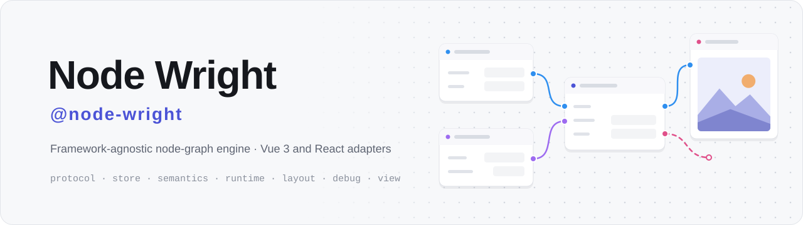
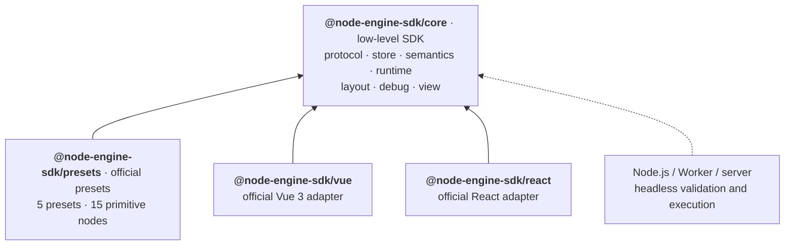

<p align="right"><b>English</b> · <a href="README.zh-CN.md">简体中文</a></p>

<p align="center">
  <picture>
    <source media="(prefers-color-scheme: dark)" srcset="docs/assets/banner-en-dark.svg">
    
  </picture>
</p>

<p align="center">
  <a href="https://github.com/ruoyu-lab/node-engine-sdk/actions/workflows/ci.yml"></a>
  
  <a href="LICENSE"></a>
  
  
  
</p>

<p align="center">
  <a href="https://ruoyu-lab.github.io/node-engine-sdk/"><b>Live Demo</b></a>
  &nbsp;·&nbsp;
  <a href="docs/README.md"><b>Docs</b></a>
  &nbsp;·&nbsp;
  <a href="#quick-start"><b>Quick Start</b></a>
  &nbsp;·&nbsp;
  <a href="CHANGELOG.md"><b>Changelog</b></a>
</p>

**Node Engine SDK** is a framework-agnostic node-graph SDK with official Vue 3 and React adapters.

`@node-engine-sdk/core` is the **low-level SDK**: graph protocol, state, semantics, runtime, layout, debugging and a framework-agnostic editor controller. `@node-engine-sdk/vue` and `@node-engine-sdk/react` are the **official adapters** that render that controller with identical behavior, and `@node-engine-sdk/presets` provides the **official preset nodes**. The same graph can be edited in the browser, or validated and executed headless in Node.js or a Worker.

<p align="center"></p>

<p align="center"><sub>Dark is the default look; compare the <a href="docs/assets/playground-ai-image-light.png">light theme screenshot</a>.</sub></p>

<p align="center"></p>

<p align="center"><sub>Drag a node → connect → run → see the image → navigate with the minimap. Captured from the playground that the <a href="https://ruoyu-lab.github.io/node-engine-sdk/">live demo</a> hosts (Vue build; there is also a <a href="https://ruoyu-lab.github.io/node-engine-sdk/react/">React build</a>). The playground UI is in Chinese.</sub></p>

<table>
  <tr>
    <td width="40%" valign="top"></td>
    <td width="40%" valign="top"></td>
    <td width="20%" valign="top"></td>
  </tr>
  <tr>
    <td align="center"><sub>Exec flow · dark</sub></td>
    <td align="center"><sub>Exec flow · light</sub></td>
    <td align="center"><sub>Phone · bottom drawer</sub></td>
  </tr>
</table>

## Features

<table>
  <tr>
    <td width="50%" valign="top">
      <b>🧠 Framework-agnostic core SDK</b><br>
      <code>@node-engine-sdk/core</code> depends on no UI framework, and everything but the editor view runs without a DOM: save, validate and run graphs in the browser, Node.js or a Worker.
    </td>
    <td width="50%" valign="top">
      <b>🧩 Official Vue 3 and React adapters</b><br>
      Both adapters render one editor controller and pass one contract test suite for props, events, the ref API and the default DOM nodes.
    </td>
  </tr>
  <tr>
    <td valign="top">
      <b>📐 Strict graph protocol</b><br>
      <code>GraphSnapshot</code> is the only persisted format, external input enters through <code>parseGraph(unknown)</code> only, and every problem is a <code>GraphDiagnostic</code>.
    </td>
    <td valign="top">
      <b>🔌 Connection semantics</b><br>
      Data-flow, exec-flow and hybrid rules: port types, capacity, cycles and required inputs, shared by interactive checks and whole-graph diagnostics.
    </td>
  </tr>
  <tr>
    <td valign="top">
      <b>⚡ Execution runtime</b><br>
      Execution plans, sequential and concurrent scheduling, variable scopes, function and subgraph calls, timeouts, idempotent retries, cancellation, breakpoints and stepping.
    </td>
    <td valign="top">
      <b>🎨 Complete canvas interaction</b><br>
      Pan and zoom, marquee selection, groups, connect and reconnect, copy and paste, undo and redo, shortcuts and context menus; DOM nodes, custom components or pure Canvas rendering.
    </td>
  </tr>
  <tr>
    <td valign="top">
      <b>📦 Official preset nodes</b><br>
      <code>@node-engine-sdk/presets</code>: 5 presets and 15 primitive nodes with DOM rendering config, semantic plugins, runtime definitions and layout strategies.
    </td>
    <td valign="top">
      <b>🧭 Auto layout</b><br>
      Headless layered layout that only returns a position patch; the app decides whether to apply it and whether it enters the undo history.
    </td>
  </tr>
  <tr>
    <td valign="top">
      <b>🌗 Dark and light themes</b><br>
      Built-in dark and light palettes for the default nodes, edges, groups and grid, switched with <code>theme.colorScheme</code>; nodes carry a per-type accent and <code>nodeStatus</code> shows running, success and error.
    </td>
    <td valign="top">
      <b>🗺️ Minimap</b><br>
      Optional overview of nodes, groups and the visible area; click, drag or use the arrow keys to pan the viewport. It only repaints when the graph or the overview range changes.
    </td>
  </tr>
</table>

## Architecture



All editor state and interaction (viewport, selection, dragging, connecting, clipboard, shortcuts, Canvas draw scheduling) lives in the controller of `@node-engine-sdk/core/view`; the Vue and React adapters only render its snapshots. Module dependency directions are enforced by tests. See [Architecture](docs/architecture.md) (in Chinese, like the rest of `docs/`).

## Quick Start

### Installation

```bash
# Vue 3
npm install @node-engine-sdk/core @node-engine-sdk/presets @node-engine-sdk/vue vue
# React
npm install @node-engine-sdk/core @node-engine-sdk/presets @node-engine-sdk/react react react-dom
```

Requirements: Node.js `>=20.19.0`, ESM-only / ES2022, Vue `^3.5.13`, React / React DOM `^18.3.0 || ^19.0.0`. See [support](docs/support.md).

The Vue and React examples below share one graph and preset:

<details>
<summary><code>demo-graph.ts</code>: a data source node wired to a preview node (click to expand)</summary>

```ts
import {
  NODE_ENGINE_GRAPH_SCHEMA_VERSION,
  type GraphSnapshot,
} from '@node-engine-sdk/core/protocol'
import {
  DATA_PREVIEW_NODE_TYPE,
  DATA_SOURCE_NODE_TYPE,
  createDataflowPreset,
} from '@node-engine-sdk/presets'

export const preset = createDataflowPreset()

export function createDemoGraph(): GraphSnapshot {
  return {
    schemaVersion: NODE_ENGINE_GRAPH_SCHEMA_VERSION,
    nodes: [
      { id: 'source', type: DATA_SOURCE_NODE_TYPE, x: 80, y: 120, data: { params: { value: 42 } } },
      { id: 'preview', type: DATA_PREVIEW_NODE_TYPE, x: 420, y: 120 },
    ],
    edges: [
      {
        id: 'source-to-preview',
        kind: 'data',
        source: { nodeId: 'source', portId: 'value' },
        target: { nodeId: 'preview', portId: 'value' },
      },
    ],
    groups: [],
    meta: {},
  }
}
```

</details>

### Vue 3

```vue
<script setup lang="ts">
import { ref } from 'vue'
import { NodeEngine } from '@node-engine-sdk/vue'
import '@node-engine-sdk/vue/style.css'
import { createDemoGraph, preset } from './demo-graph'

const graph = ref(createDemoGraph())
</script>

<template>
  <div style="height: 600px">
    <NodeEngine
      v-model:graph="graph"
      :node-definitions="preset.nodeDefinitions"
      :node-types="preset.nodeTypes"
      :plugins="preset.plugins"
      :initial-viewport="preset.initialViewport"
    />
  </div>
</template>
```

### React

```tsx
import { useState } from 'react'
import { NodeEngine } from '@node-engine-sdk/react'
import '@node-engine-sdk/react/style.css'
import { createDemoGraph, preset } from './demo-graph'

export function Editor() {
  const [graph, setGraph] = useState(createDemoGraph)

  return (
    <div style={{ height: 600 }}>
      <NodeEngine
        graph={graph}
        onGraphChange={setGraph}
        nodeDefinitions={preset.nodeDefinitions}
        nodeTypes={preset.nodeTypes}
        plugins={preset.plugins}
        initialViewport={preset.initialViewport}
      />
    </div>
  )
}
```

The editor root fills `100%` of its parent, so give the parent a definite height. Keep the React preset at module level so renders do not rebuild the internal store. The component ref exposes the full [`NodeEngineApi`](docs/controller-api.md#nodeengineapi-全表); see [getting started](docs/getting-started.md), the [Vue adapter](docs/vue-adapter.md) and the [React adapter](docs/react-adapter.md).

### Headless runtime

The same graph runs in Node.js without any UI:

```ts
import { NodeEngineRuntime } from '@node-engine-sdk/core/runtime'
import { createDemoGraph, preset } from './demo-graph'

const runtime = new NodeEngineRuntime({
  graph: createDemoGraph(), // graphs from files or APIs go through parseGraph first
  definitions: preset.nodeDefinitions,
  runtimeDefinitions: preset.runtimeDefinitions,
})
const compiled = runtime.compile('preview') // start at preview and evaluate its data upstream
if (!compiled.plan) throw new Error(compiled.diagnostics[0]?.message)

const result = await runtime.run(compiled.plan)
console.log(result.status, result.nodeStates.preview?.inputValues) // 'success' { value: 42 }
```

## Packages

| Package                    | Role                   | Contents                                                                                        | Subpaths                                                                                                               |
| -------------------------- | ---------------------- | ----------------------------------------------------------------------------------------------- | ---------------------------------------------------------------------------------------------------------------------- |
| `@node-engine-sdk/core`    | Low-level SDK          | Protocol, state, semantics, runtime, layout, debugging and the editor controller; runs headless | `.` (protocol + store)<br>`/protocol` `/store` `/semantics` `/runtime`<br>`/layout` `/debug` `/view` `/view/style.css` |
| `@node-engine-sdk/presets` | Official preset nodes  | 5 presets and 15 primitive nodes                                                                | `.` `/nodes/dataflow` `/nodes/execflow`<br>`/nodes/function` `/nodes/subgraph`                                         |
| `@node-engine-sdk/vue`     | Official Vue 3 adapter | Editor component                                                                                | `.` `/style.css`                                                                                                       |
| `@node-engine-sdk/react`   | Official React adapter | Editor component and hook                                                                       | `.` `/style.css`                                                                                                       |

Every subpath export is listed in [core-api.md](docs/core-api.md) and [presets-api.md](docs/presets-api.md).

## Live demo

[ruoyu-lab.github.io/node-engine-sdk](https://ruoyu-lab.github.io/node-engine-sdk/) hosts this repository's playground: the Vue build at the site root and the [React build](https://ruoyu-lab.github.io/node-engine-sdk/react/) under `/react/`, with a switch at the bottom of the scenario list. It contains an AI image workflow and four primitive scenarios (data flow, exec flow, functions, subgraphs). The interface is a full-screen canvas with floating panels: scenario list, toolbar, run panel, minimap and zoom controls. It follows the system's dark or light preference and switches from the toolbar; on phones the run panel becomes a bottom drawer. The AI image scenario calls the public Pollinations image API, so it needs network access but no key; the primitive scenarios run entirely in the browser. To run it locally: `npm install && npm run dev` (React: `npm run dev:react`); see [Playground](docs/playground-demo.md).

## Documentation

Start at the [documentation index](docs/README.md). The documentation is written in Simplified Chinese; code samples and identifiers are in English. Common entry points: [getting started](docs/getting-started.md) · [architecture](docs/architecture.md) · [editor controller API](docs/controller-api.md) · [Vue adapter](docs/vue-adapter.md) · [React adapter](docs/react-adapter.md) · [runtime API](docs/runtime-api.md) · [writing business nodes](docs/node-definition-guide.md) · [playground](docs/playground-demo.md)

## Project status

`0.1.0-beta.2` is a beta release: APIs may still change. See [CHANGELOG.md](CHANGELOG.md).

<details>
<summary>What this release covers and what it does not</summary>

- Included: the low-level SDK (strict graph protocol, semantic rules, runtime, layout, debug helpers, the framework-agnostic editor controller and `NodeEngineApi`), the official Vue 3 and React adapters, the official presets with 15 primitive nodes, and the Vue and React playgrounds.
- Quality gates: strict TypeScript, type-aware ESLint, Prettier, coverage thresholds, real-tarball consumer tests (including Vue / React SSR and a React 18 consumer), three-engine E2E for both playground apps, and a 5,000-node performance budget.
- Not included yet: React 18 DOM component tests (covered by the packed consumer's type check and SSR); product features such as node search, persistence, collaboration, and entering or leaving subgraphs (no placeholder APIs); adapters for other UI frameworks (build one on `@node-engine-sdk/core/view` and the contract tests).

</details>

## Contributing

Issues and pull requests are welcome. Development workflow, commands, module boundaries and naming rules are in [CONTRIBUTING.md](CONTRIBUTING.md) (in Chinese); run `npm run verify` before submitting.

## License

[MIT](LICENSE)
