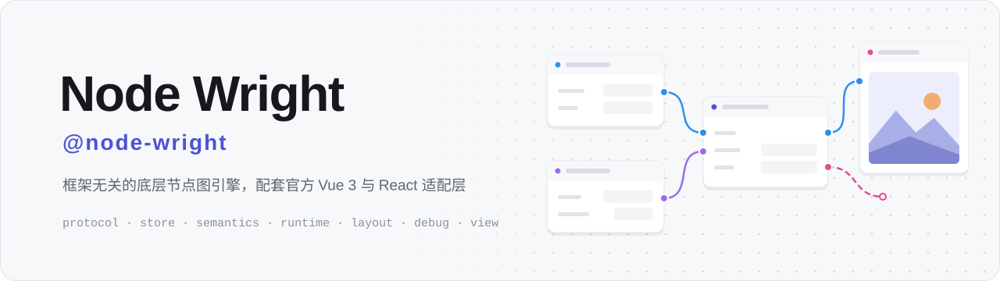
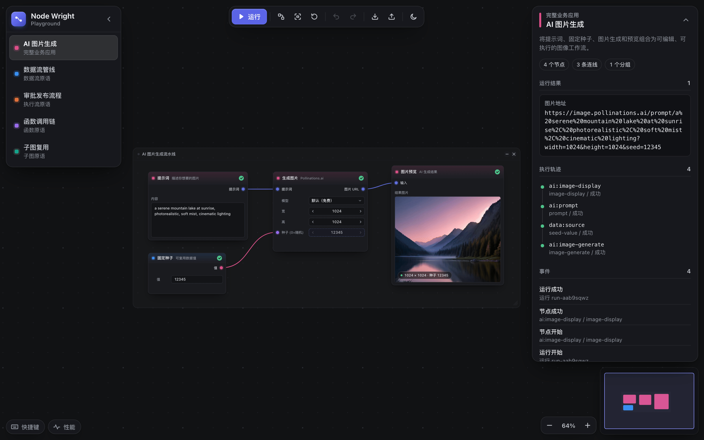
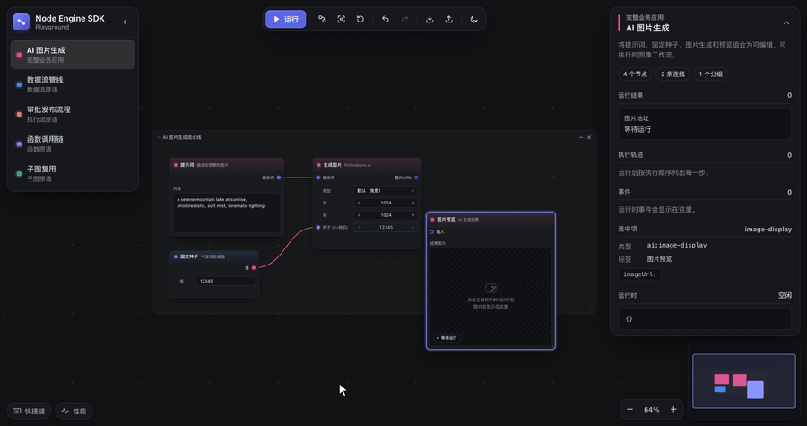
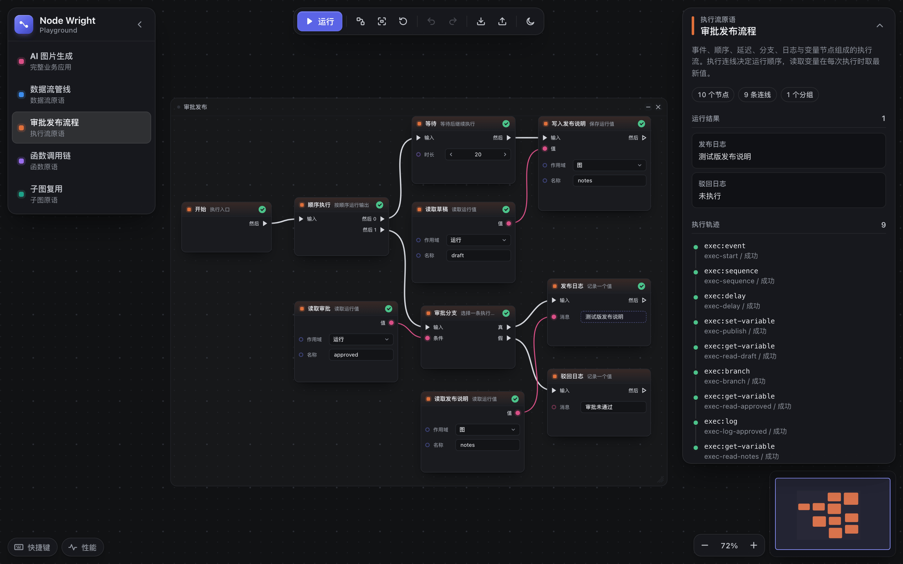
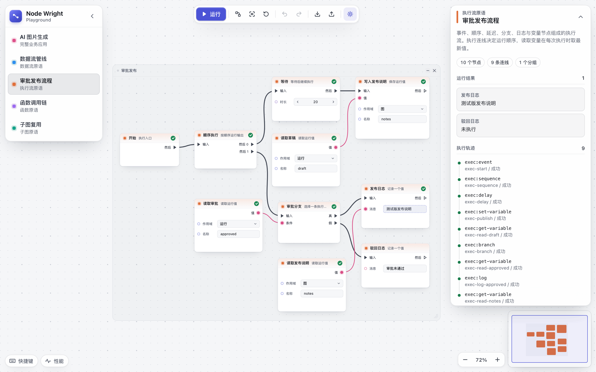
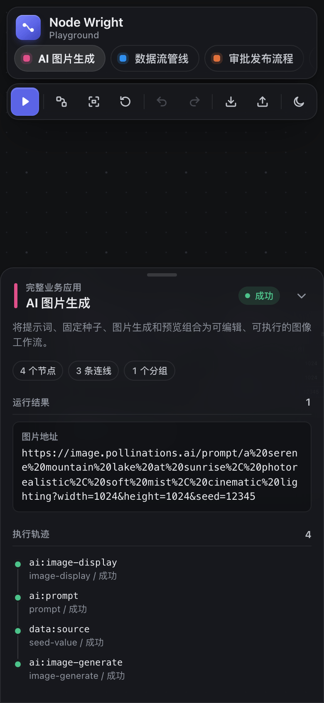
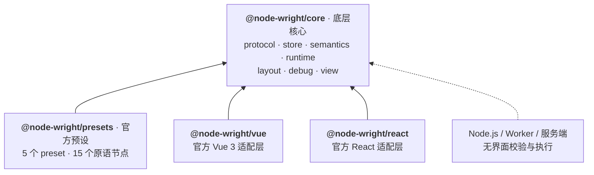

<p align="right"><a href="README.md">English</a> · <b>简体中文</b></p>

<p align="center">
  <picture>
    <source media="(prefers-color-scheme: dark)" srcset="docs/assets/banner-dark.svg">
    
  </picture>
</p>

<p align="center">
  <a href="https://github.com/ruoyu-lab/node-wright/actions/workflows/ci.yml"></a>
  
  <a href="LICENSE"></a>
  
  
  
</p>

<p align="center">
  <a href="https://ruoyu-lab.github.io/node-wright/"><b>在线 Demo</b></a>
  &nbsp;·&nbsp;
  <a href="docs/README.md"><b>文档</b></a>
  &nbsp;·&nbsp;
  <a href="#快速开始"><b>快速开始</b></a>
  &nbsp;·&nbsp;
  <a href="CHANGELOG.md"><b>更新日志</b></a>
</p>

**Node Wright** 是一个框架无关的节点图引擎，配套官方 Vue 3 与 React 适配层。

`@node-wright/core` 是**底层核心**：图协议、状态、语义、运行时、布局、调试，以及框架无关的编辑器控制器；`@node-wright/vue` 与 `@node-wright/react` 是**官方适配层**，只负责把控制器渲染出来，行为一致；`@node-wright/presets` 提供**官方预设节点**。同一份图既能在浏览器里编辑，也能在 Node.js 或 Worker 中无界面校验和执行。

<p align="center"></p>

<p align="center"><sub>深色主题为默认外观，<a href="docs/assets/playground-ai-image-light.png">浅色主题截图</a>可作对照。</sub></p>

<p align="center"></p>

<p align="center"><sub>拖动节点 → 连线 → 运行 → 出图 → 小地图导航。画面截自 playground，也就是 <a href="https://ruoyu-lab.github.io/node-wright/">在线 Demo</a>（Vue 版，另有 <a href="https://ruoyu-lab.github.io/node-wright/react/">React 版</a>）。</sub></p>

<table>
  <tr>
    <td width="40%" valign="top"></td>
    <td width="40%" valign="top"></td>
    <td width="20%" valign="top"></td>
  </tr>
  <tr>
    <td align="center"><sub>执行流场景 · 深色</sub></td>
    <td align="center"><sub>执行流场景 · 浅色</sub></td>
    <td align="center"><sub>窄屏 · 底部抽屉</sub></td>
  </tr>
</table>

## 特性

<table>
  <tr>
    <td width="50%" valign="top">
      <b>🧠 框架无关的底层核心</b><br>
      <code>@node-wright/core</code> 不依赖任何 UI 框架，除编辑器视图外都不需要 DOM，图可以在浏览器、Node.js、Worker 中保存、校验和执行。
    </td>
    <td width="50%" valign="top">
      <b>🧩 官方 Vue 3 / React 适配层</b><br>
      两个适配层渲染同一个编辑器控制器，props、事件、ref API 与默认 DOM 节点通过同一份契约测试，行为一致。
    </td>
  </tr>
  <tr>
    <td valign="top">
      <b>📐 严格的图协议</b><br>
      <code>GraphSnapshot</code> 是唯一持久化格式，外部输入只经 <code>parseGraph(unknown)</code> 进入，诊断统一为 <code>GraphDiagnostic</code>。
    </td>
    <td valign="top">
      <b>🔌 连线语义</b><br>
      数据流、执行流、混合流规则；端口类型、容量、环路与必填输入，交互校验与整图诊断共用一套规则。
    </td>
  </tr>
  <tr>
    <td valign="top">
      <b>⚡ 执行运行时</b><br>
      执行计划、顺序与并发调度、变量作用域、函数与子图调用、超时与幂等重试、取消、断点与单步。
    </td>
    <td valign="top">
      <b>🎨 完整的画布交互</b><br>
      平移缩放、框选、分组、连线与重连、复制粘贴、撤销重做、快捷键、右键菜单；DOM 节点、自定义组件或纯 Canvas 渲染。
    </td>
  </tr>
  <tr>
    <td valign="top">
      <b>📦 官方预设节点</b><br>
      <code>@node-wright/presets</code>：5 个 preset、15 个原语节点，自带 DOM 渲染配置、语义插件、Runtime 定义与布局策略。
    </td>
    <td valign="top">
      <b>🧭 自动布局</b><br>
      headless 分层布局只输出位置 patch，是否写回、是否进入撤销历史由应用决定。
    </td>
  </tr>
  <tr>
    <td valign="top">
      <b>🌗 深浅两套主题</b><br>
      默认节点、连线、分组与网格各有深色和浅色调色板，<code>theme.colorScheme</code> 一键切换；节点按类型强调色区分，<code>nodeStatus</code> 显示运行中、成功与失败。
    </td>
    <td valign="top">
      <b>🗺️ 小地图</b><br>
      可选的缩略图导航：显示节点、分组与当前可见区域，点击、拖动或方向键平移视口；只在图或视口范围变化时重绘。
    </td>
  </tr>
</table>

## 架构



编辑器的全部状态与交互（视口、选区、拖拽、连线、剪贴板、快捷键、Canvas 绘制调度）都在 `@node-wright/core/view` 的控制器里，Vue 与 React 适配层只把控制器快照渲染出来。模块依赖方向由测试静态检查，详见 [架构](docs/architecture.md)。

## 快速开始

### 安装

```bash
# Vue 3
npm install @node-wright/core @node-wright/presets @node-wright/vue vue
# React
npm install @node-wright/core @node-wright/presets @node-wright/react react react-dom
```

运行环境：Node.js `>=20.19.0`，ESM-only / ES2022，Vue `^3.5.13`，React / React DOM `^18.3.0 || ^19.0.0`，详见 [运行环境与兼容范围](docs/support.md)。

下面的 Vue 与 React 示例共用同一份图和 preset：

<details>
<summary><code>demo-graph.ts</code>：一个数据源节点连到一个预览节点（点击展开）</summary>

```ts
import { NODE_WRIGHT_GRAPH_SCHEMA_VERSION, type GraphSnapshot } from '@node-wright/core/protocol'
import {
  DATA_PREVIEW_NODE_TYPE,
  DATA_SOURCE_NODE_TYPE,
  createDataflowPreset,
} from '@node-wright/presets'

export const preset = createDataflowPreset()

export function createDemoGraph(): GraphSnapshot {
  return {
    schemaVersion: NODE_WRIGHT_GRAPH_SCHEMA_VERSION,
    nodes: [
      { id: 'source', type: DATA_SOURCE_NODE_TYPE, x: 80, y: 120, data: { params: { value: 42 } } },
      { id: 'preview', type: DATA_PREVIEW_NODE_TYPE, x: 420, y: 120 },
    ],
    edges: [
      {
        id: 'source-to-preview',
        kind: 'data',
        source: { nodeId: 'source', portId: 'value' },
        target: { nodeId: 'preview', portId: 'value' },
      },
    ],
    groups: [],
    meta: {},
  }
}
```

</details>

### Vue 3

```vue
<script setup lang="ts">
import { ref } from 'vue'
import { NodeWright } from '@node-wright/vue'
import '@node-wright/vue/style.css'
import { createDemoGraph, preset } from './demo-graph'

const graph = ref(createDemoGraph())
</script>

<template>
  <div style="height: 600px">
    <NodeWright
      v-model:graph="graph"
      :node-definitions="preset.nodeDefinitions"
      :node-types="preset.nodeTypes"
      :plugins="preset.plugins"
      :initial-viewport="preset.initialViewport"
    />
  </div>
</template>
```

### React

```tsx
import { useState } from 'react'
import { NodeWright } from '@node-wright/react'
import '@node-wright/react/style.css'
import { createDemoGraph, preset } from './demo-graph'

export function Editor() {
  const [graph, setGraph] = useState(createDemoGraph)

  return (
    <div style={{ height: 600 }}>
      <NodeWright
        graph={graph}
        onGraphChange={setGraph}
        nodeDefinitions={preset.nodeDefinitions}
        nodeTypes={preset.nodeTypes}
        plugins={preset.plugins}
        initialViewport={preset.initialViewport}
      />
    </div>
  )
}
```

编辑器根元素宽高为 `100%`，父容器需要确定的高度；React 版的 preset 放在模块级，避免每次渲染重建内部 Store。组件 ref 暴露完整的 [`NodeWrightApi`](docs/controller-api.md#nodewrightapi-全表)，更多用法见 [快速上手](docs/getting-started.md)、[Vue 适配层](docs/vue-adapter.md) 与 [React 适配层](docs/react-adapter.md)。

### 无界面运行

同一份图不经过任何 UI，直接在 Node.js 中执行：

```ts
import { NodeWrightRuntime } from '@node-wright/core/runtime'
import { createDemoGraph, preset } from './demo-graph'

const runtime = new NodeWrightRuntime({
  graph: createDemoGraph(), // 来自文件或接口的图先经 parseGraph 严格解析
  definitions: preset.nodeDefinitions,
  runtimeDefinitions: preset.runtimeDefinitions,
})
const compiled = runtime.compile('preview') // 以 preview 为入口，向上游求值数据依赖
if (!compiled.plan) throw new Error(compiled.diagnostics[0]?.message)

const result = await runtime.run(compiled.plan)
console.log(result.status, result.nodeStates.preview?.inputValues) // 'success' { value: 42 }
```

## 包

| 包                     | 定位              | 内容                                                             | 子路径                                                                                                                  |
| ---------------------- | ----------------- | ---------------------------------------------------------------- | ----------------------------------------------------------------------------------------------------------------------- |
| `@node-wright/core`    | 底层核心          | 协议、状态、语义、运行时、布局、调试与编辑器控制器，可无界面运行 | `.`（protocol + store）<br>`/protocol` `/store` `/semantics` `/runtime`<br>`/layout` `/debug` `/view` `/view/style.css` |
| `@node-wright/presets` | 官方预设节点      | 5 个 preset 与 15 个原语节点                                     | `.` `/nodes/dataflow` `/nodes/execflow`<br>`/nodes/function` `/nodes/subgraph`                                          |
| `@node-wright/vue`     | 官方 Vue 3 适配层 | 编辑器组件                                                       | `.` `/style.css`                                                                                                        |
| `@node-wright/react`   | 官方 React 适配层 | 编辑器组件与 Hook                                                | `.` `/style.css`                                                                                                        |

每个子路径的导出见 [core-api.md](docs/core-api.md) 与 [presets-api.md](docs/presets-api.md)。

## 在线 Demo

[ruoyu-lab.github.io/node-wright](https://ruoyu-lab.github.io/node-wright/) 部署的是本仓库的 playground（Vue 版在站点根路径，[React 版](https://ruoyu-lab.github.io/node-wright/react/) 在 `/react/`，场景列表底部可互相切换），包含 AI 图片工作流与数据流、执行流、函数、子图 4 个原语场景。界面是全屏画布加浮动面板：场景列表、工具条、运行面板、小地图与缩放控件，跟随系统深浅色并可在工具条切换；窄屏下运行面板变为底部抽屉。AI 图片场景会请求公开的 Pollinations 图片接口，需要联网，不使用任何密钥；4 个原语场景完全在浏览器本地运行。本地运行：`npm install && npm run dev`（React 版 `npm run dev:react`），见 [Playground](docs/playground-demo.md)。

## 文档

从 [文档索引](docs/README.md) 开始。常用入口：[快速上手](docs/getting-started.md) · [架构](docs/architecture.md) · [编辑器控制器 API](docs/controller-api.md) · [Vue 适配层](docs/vue-adapter.md) · [React 适配层](docs/react-adapter.md) · [Runtime API](docs/runtime-api.md) · [开发业务节点](docs/node-definition-guide.md) · [Playground](docs/playground-demo.md)

## 项目状态

`0.1.0-beta.3` 是测试版：API 仍可能调整。变更记录见 [CHANGELOG.md](CHANGELOG.md)。

<details>
<summary>本版本范围与尚未包含的能力</summary>

- 包含：底层核心（严格图协议、语义规则、运行时、布局、调试辅助、框架无关的编辑器控制器与 `NodeWrightApi`）、官方 Vue 3 / React 适配层、含 15 个原语节点的官方预设，以及 Vue / React 两个 playground。
- 质量门禁：严格 TypeScript、类型感知 ESLint、Prettier、覆盖率阈值、真实 tarball 消费者测试（含 Vue / React SSR 与 React 18 消费者）、Vue / React 双应用的三引擎 E2E、5,000 节点性能预算。
- 尚未包含：React 18 的 DOM 组件测试（由打包消费者的类型检查与 SSR 覆盖）；节点搜索、持久化、多人协作、子图进入/返回等产品能力（Node Wright 不提供占位 API）；其他 UI 框架适配层（可基于 `@node-wright/core/view` 与契约测试自行实现）。

</details>

## 参与贡献

欢迎提交 Issue 与 Pull Request。开发流程、常用命令、模块边界与命名规则见 [CONTRIBUTING.md](CONTRIBUTING.md)，提交前请运行 `npm run verify`。

## 许可

[MIT](LICENSE)
