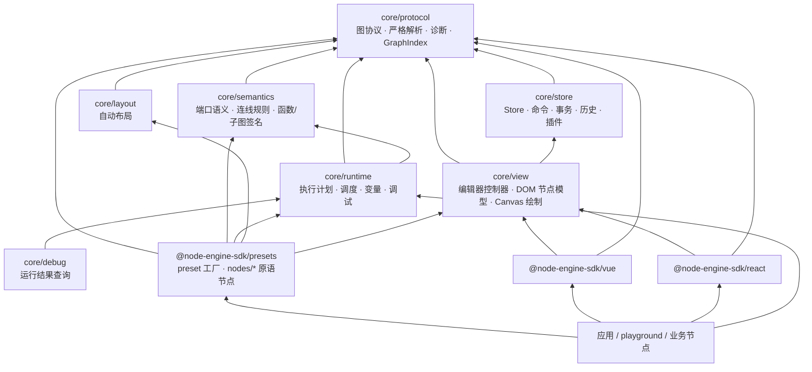
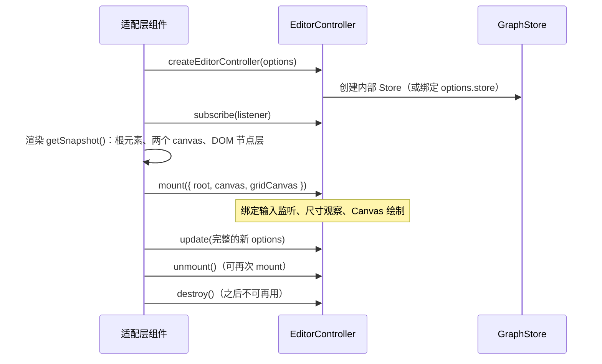
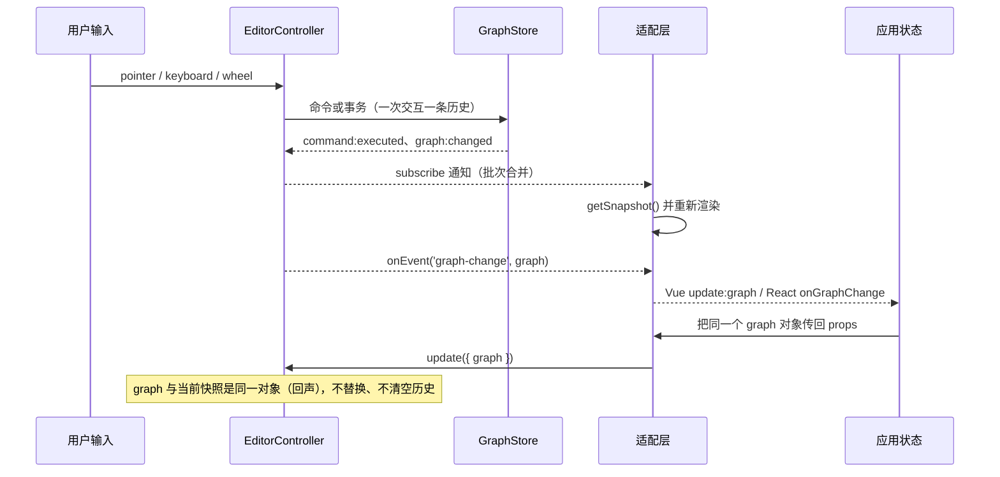

# 架构

Node Engine SDK 的目标是一个框架无关的节点图 SDK，而不是某个框架里的画布组件。底层 SDK `@node-engine-sdk/core` 承载所有与 UI 框架无关的能力，按领域分为七个模块；官方预设节点 `@node-engine-sdk/presets` 组合标准能力；官方适配层 `@node-engine-sdk/vue` 与 `@node-engine-sdk/react` 只负责把 `@node-engine-sdk/core/view` 的控制器快照渲染成各自框架的组件。

## 分层

箭头表示“依赖”。图中是当前源码实际存在的依赖；允许的范围见下文的模块边界约束。

| 层         | 位置                                             | 负责                                                                                                       | 不负责                                   |
| ---------- | ------------------------------------------------ | ---------------------------------------------------------------------------------------------------------- | ---------------------------------------- |
| 协议       | `@node-engine-sdk/core/protocol`                 | `GraphSnapshot`、节点/边定义、参数 schema、解析/校验/修复、诊断、扩展 manifest、执行计划类型、`GraphIndex` | 状态、交互、执行                         |
| 状态       | `@node-engine-sdk/core/store`                    | `GraphStore`、内置命令、事务、历史、注册表、插件生命周期、连接校验                                         | 语义规则、UI、执行                       |
| 语义       | `@node-engine-sdk/core/semantics`                | 端口 kind/类型/容量/环路/必填规则、流程插件、值类型、函数/子图/变量引用                                    | 默认节点、UI、handler                    |
| 布局       | `@node-engine-sdk/core/layout`                   | 根据图结构计算节点与分组位置 patch                                                                         | DOM 测量、动画、历史                     |
| 运行       | `@node-engine-sdk/core/runtime`                  | 编译执行计划、数据求值、执行流、调度、变量、函数、子图、断点、事件                                         | 视口、选区、组件                         |
| 调试       | `@node-engine-sdk/core/debug`                    | 对 `NodeEngineRunResult` 做汇总与查询                                                                      | 修改图、UI                               |
| 视图       | `@node-engine-sdk/core/view`                     | 编辑器状态与交互、`NodeEngineApi`、DOM 节点模型、Canvas 绘制调度、共享样式                                 | 任何 UI 框架、业务执行逻辑               |
| 官方预设   | `@node-engine-sdk/presets`                       | 原语节点定义与 handler、DOM 渲染配置、语义插件、Runtime definitions、布局策略、初始视口                    | 创建 Runtime 实例、业务 handler、UI 框架 |
| 官方适配层 | `@node-engine-sdk/vue`、`@node-engine-sdk/react` | 渲染控制器快照、转发事件、暴露 API、注册 DOM 节点组件、默认 DOM 节点                                       | 编辑器状态、交互算法、业务逻辑           |
| 应用       | 业务项目 / playground                            | 业务节点、业务 UI、持久化、运行编排                                                                        | 图协议与编辑器契约                       |

## 模块边界约束

边界由测试静态检查，违反即测试失败。

### core 内部（`packages/core/test/module-boundaries.test.ts`）

| 模块        | 允许依赖                                    | 当前实际依赖        |
| ----------- | ------------------------------------------- | ------------------- |
| `protocol`  | 无                                          | 无                  |
| `store`     | protocol                                    | protocol            |
| `semantics` | protocol                                    | protocol            |
| `layout`    | protocol                                    | protocol            |
| `runtime`   | protocol、store、semantics、layout          | protocol、semantics |
| `debug`     | protocol、store、semantics、layout、runtime | runtime             |
| `view`      | protocol、store、semantics、runtime、layout | protocol、store     |

此外：

- 每个源文件必须位于根入口 `src/index.ts` 或上述某个模块目录中；每个模块都有 `index.ts` 入口。
- 只能使用解析到源文件的相对导入；跨模块只能经过对方的 `index.ts`。
- 模块依赖图无环；源文件之间的值导入（非 `import type`）也无环。
- 只有 `view` 可以使用浏览器全局（`window`、`document`、`HTMLElement`、`PointerEvent`、`requestAnimationFrame`、`ResizeObserver` 等）；其余模块必须能在 Node.js 中运行。
- core 任何位置都不导入 UI 框架（vue、react、react-dom、preact、svelte、solid-js）。
- 根入口 `@node-engine-sdk/core` 只导出 `protocol` 与 `store`。

### 包之间（`packages/presets/test/package-boundaries.test.ts`）

- workspace 恰好包含 `core`、`presets`、`react`、`vue` 四个包，版本与内部依赖版本统一为 `0.1.0-beta.3`。
- 每个包声明的 `@node-engine-sdk/*` 依赖与源码实际导入完全一致；core 源码不导入任何 `@node-engine-sdk/*` 包。
- 两个 UI 适配层只导入 `@node-engine-sdk/core/protocol` 与 `@node-engine-sdk/core/view`，不导入 semantics/runtime/layout/debug，也不导入对方的 UI 框架。
- presets 只依赖 `@node-engine-sdk/core`，不导入任何 UI 框架；`nodes/*` 下的节点系统不导入 preset 组装代码；presets 源码不创建 `NodeEngineRuntime`。
- playground 只通过 `@node-engine-sdk/presets` 根入口使用标准节点；AI、HTTP（`fetch`）等业务实现只能存在于 playground。
- 发布清单统一：ESM（`type: module`）、`engines.node >=20.19.0`、`files: ["dist", "README.md"]`、`exports` 与源码入口一一对应、`sideEffects` 只声明样式文件。
- 适配层公开声明的相对导入带 `.js`（或 `.vue`）扩展名，保证 NodeNext 消费者可解析。
- 不发布未实现产品能力的占位 API（持久化、搜索等）。

## 控制器契约

`@node-engine-sdk/core/view` 的 `createEditorController(options)` 是所有 UI 适配层共享的唯一编辑器实现。它的生命周期与职责划分：

- 控制器持有全部编辑器状态：视口、选区、拖拽、连线、框选、缩放、剪贴板、快捷键、节点编辑器、右键菜单、可见性裁剪、性能采样与 Canvas 绘制调度。
- `getSnapshot()` 返回不可变的 `NodeEngineViewSnapshot`，状态未变化时返回同一个对象；`subscribe` 的通知按批次合并，适合 React `useSyncExternalStore` 或 Vue `shallowRef`。
- `update(options)` 接收完整的选项对象，只有引用变化的字段生效；`initialViewport`、`initialSelection` 只在创建时读取。
- `mount` 只在宿主元素渲染完成后调用；控制器创建与 `update` 不访问 DOM，因此可以在服务端渲染时创建。
- 所有编辑器事件通过 `options.onEvent(name, ...args)` 发出，适配层负责转换为各自框架的事件机制。
- 适配层只渲染快照、把 DOM 元素交给 `mount`、把 props 交给 `update`，并按 `component` 键渲染 DOM 节点组件。

完整契约与字段表见 [controller-api.md](./controller-api.md)。Vue 与 React 适配层运行同一份框架无关的契约测试（`packages/core/test/view/adapter-contract.ts`），新的适配层实现同样的 driver 即可证明行为一致。

## 数据流

- 拖拽、缩放、连线预览等交互过程中只更新控制器内部的预览状态（`graph.getLive()` 可读取），交互结束时才提交一条命令，事件 payload 中同时提供 `graph` 与 `liveGraph`。
- 应用传入一个新的图对象时，控制器调用 `replaceGraph` 替换并清空历史；需要可撤销的整图替换时使用 `api.graph.apply()`。
- 注册表类选项（`nodeDefinitions`、`edgeDefinitions`、`commands`、`plugins`、`connectionValidator`）引用变化时，控制器以当前图重建内部 Store，撤销历史随之清空。
- 传入外部 `store` 时，图与注册表都由该 Store 持有：同时传入 `graph` 或上述注册表选项会直接抛错，编辑器只读取插件的 `components` 贡献（节点类型、渲染器、菜单等，贡献 Store 内容的插件须已注册在该 Store 中），也不会在销毁时释放它。

## 状态归属

| 状态                                   | 归属                                 | 是否持久化                  |
| -------------------------------------- | ------------------------------------ | --------------------------- |
| 节点、边、分组、图元数据               | `GraphSnapshot`（`GraphStore` 持有） | 是                          |
| 撤销/重做历史                          | `GraphStore`                         | 否                          |
| 视口、选区、交互状态、菜单、节点编辑器 | `EditorController`                   | 否（由应用自行决定）        |
| 节点类型、渲染器、工具栏、菜单、快捷键 | 编辑器选项与插件 `components`        | 否（代码配置）              |
| 运行状态、变量、trace、调用帧          | 单次 `NodeEngineRuntime.run()`       | 否（`NodeEngineRunResult`） |

## 扩展入口

- 只需要图协议、保存格式或诊断：`@node-engine-sdk/core/protocol`。
- 需要无界面编辑、历史、命令与插件：`@node-engine-sdk/core/store`（或根入口 `@node-engine-sdk/core`）。
- 需要连线规则：`@node-engine-sdk/core/semantics` 的流程插件或自定义规则。
- 需要执行：`@node-engine-sdk/core/runtime`；需要查询运行结果：`@node-engine-sdk/core/debug`。
- 需要自动排布：`@node-engine-sdk/core/layout`，或 preset 的 `layout`。
- 需要编辑器：Vue 用 `@node-engine-sdk/vue`，React 用 `@node-engine-sdk/react`；其他框架基于 `@node-engine-sdk/core/view` 编写适配层并运行契约测试。
- 需要开箱即用的组合：`@node-engine-sdk/presets`。
- 业务领域节点形成稳定集合时，在业务方自己的命名空间下发布独立包（例如 `@my-org/nodes-ticket`），SDK 不为业务领域预留包名。

## 设计约束

- 不提供兼容层：不保留旧 API 别名、旧字段、双轨入口或兼容分支。
- 外部图数据只能经 `parseGraph(unknown)` 进入；`GraphStore` 拒绝协议结构错误，语义诊断只用于展示，不阻止加载。
- 一个能力只有一个正式入口：例如整图导出只有 `api.graph.export()`，分组删除只有 `api.groups.remove()`。
- presets 只组合正式定义与配置，不持有业务 handler 或应用状态；默认节点系统可以提供定义与 runtime handler，但不持有 UI 状态。
- 类型系统、子图、调度器与自动布局都不是 Store 的硬规则，由应用按需启用。
